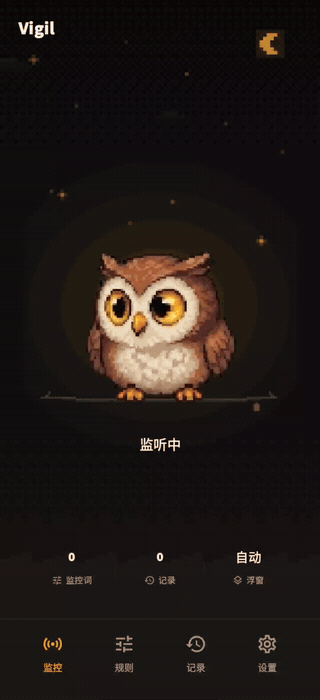

<div align="center">


# Vigil

Android 本地通知关键词报警应用。在设备本地按关键词筛选通知，命中后响铃并在当前应用上方弹出悬浮窗确认停铃。

[使用场景](#你会在哪儿用到它) · [预览](#预览) · [快速开始](#快速开始) · [核心能力](#核心能力) · [使用前注意](#使用前注意) · [路线规划](#路线规划) · [文档与许可](#文档与许可)

[](https://github.com/XGWNJE/Vigil/releases/latest) [](#快速开始) [](LICENSE)

</div>

## 你会在哪儿用到它

**适合** 需要盯着线上告警、紧急消息或特定通知，不想被普通推送淹没、也不想漏掉关键提醒的 Android 用户。  
**先别用** 如果你的手机系统禁止后台常驻且不方便关闭省电限制，或希望在设备关机状态下依然按时响铃。

| 时刻 | 你做什么 | Vigil 替你省掉什么 |
| --- | --- | --- |
| **值班盯告警** | 在「规则」里添加 `告警`、`故障` 并选定工作群应用 | 不用反复亮屏翻通知栏，命中即刻响铃 |
| **刷其他应用时** | 授予应用外浮窗权限，选择顶部 / 居中 / 角落样式 | 触发时直接在当前界面上方浮窗确认停铃，无需切出原应用 |
| **错峰或定时提醒** | 给指定关键词配置固定延时或每日定点时间 | 避免当下被打断，到点后再响铃提醒 |

## 预览

真机实录演示，均未触发实际响铃：左侧展示浅色昼景下点击像素猫头鹰切换「监听中 / 已停止」状态，右侧展示深色星夜场景及在「设置」中预览应用外系统浮窗的效果。

| 浅色昼景 · 点击猫头鹰启停监听 | 深色星夜 · 夜间巡逻与浮窗预览 |
| --- | --- |
|  |  |

## 快速开始

[下载最新 APK](https://github.com/XGWNJE/Vigil/releases/latest) · [查看发行说明](release-notes/) · [反馈问题](https://github.com/XGWNJE/Vigil/issues)

### 前置条件

- Android 8.0（API 26）及以上设备；Android 13 及以上需允许发送通知。
- 需授予系统「通知使用权」；如需在不切换应用时直接弹悬浮窗停铃，需授予「显示在其他应用上层」权限。

### 使用步骤

1. 安装 APK 并打开 Vigil，按首次启动「开启核心权限」弹窗顺序授予通知使用权、发送通知（必需）以及系统悬浮窗、电池白名单（推荐）。
2. 在底部「**规则**」添加监控关键词，按需开启「应用过滤」只监听指定应用。
3. 在底部「**设置**」配置默认铃声、默认循环次数与默认延时报警，并按需确认「系统悬浮窗」授权（浮窗样式支持自动 / 顶部 / 居中 / 角落，点选即预览）。
4. 回到「**监控**」点击居中的像素猫头鹰哨兵开关开启监听；报警触发时点浮窗中的「已知晓，停止报警」即可停铃。

### 本地源码构建

需安装 JDK 17+ 与 Android SDK（API 35）：

```bash
git clone https://github.com/XGWNJE/Vigil.git
cd Vigil
./gradlew :app:assembleDebug
```

构建成功后，调试安装包位于 `app/build/outputs/apk/debug/app-debug.apk`。完整构建、签名与发布流程见 [构建与发布手册](docs/release.md)。

## 核心能力

- **单一入口与自适应界面**：采用暖黑石墨（深色）与暖纸白（浅色）双外观，窄屏使用 4 格底栏（监控 / 规则 / 记录 / 设置），宽屏自动切换左侧图标轨与双栏布局；主页采用随浅色昼景与深色星夜自适应切换的动态像素树梢场景，居中像素猫头鹰开关以 6 组动画（休眠、按压回弹、唤醒连接、多动作巡逻监听、异常困惑、报警鸣叫）直观反馈运行状态。
- **应用外系统浮窗告警**：支持顶部悬浮卡、居中强提醒、宽屏角落浮窗三种形态及自动适配，悬浮窗正常展示时不重复弹通知栏横幅；未授予悬浮窗权限时自动降级为高优先级通知与应用内弹窗兜底。
- **精细化匹配规则**：支持多关键词监控、按来源应用过滤、同一通知更新内容重新匹配，以及关键词级铃声、播放次数（1–10 次）与重复提醒冷却间隔。
- **延时与定点报警**：支持立即触发、固定时长延时与每日多定点触发，可在设置中查看或取消待触发项。
- **铃声库与报警记录**：内置 6 条语音预设，支持导入本地音频、应用内录音、试听与管理；在「记录」页查看最近 100 条历史触发与结束方式。
- **本地隐私与诊断**：关键词匹配与铃声播放完全在设备本地完成，诊断日志不记录通知正文；支持从 GitHub 检查并校验安装包更新。

## 使用前注意

- 厂商省电策略可能中断后台监听，建议按「设置」页引导加入电池白名单；闹钟音量与系统勿扰规则会影响实际出声，Vigil 不会修改系统勿扰设置。
- Android 12 及以上未授予「闹钟和提醒」权限时，延时报警可能晚于设定时间；设备关机期间不会响铃，重启后不保证按原计划准点触发。
- 即时报警队列与待触发延时列表上限各为 20 项；进程重建后只恢复 30 分钟内且尚有播放次数的报警，超过到期时间 12 小时的延时项会丢弃。
- 开启「仅监听指定应用」但未勾选任何应用时，不会匹配任何通知；铃声选择「静音」不会出声，但仍会弹出确认界面。
- 详细的数据处理与备份范围见 [隐私政策](PRIVACY.md)。

## 路线规划

> [!NOTE]
> **接下来，值得期待**
>
> 以下是正在考虑的未来方向，不保证一定开发或交付；内容与优先顺序可能调整。

| 方向 | 你可以期待什么 | 当前状态 |
| --- | --- | --- |
| **真机锁屏与连续/延时报警验收** | 进一步核对锁屏显示与唤醒标记、连续/延时报警真机闭环及主流国产 ROM 长时间后台表现 | 🔎 评估中 · 未排期 |

完整规划与已实现能力汇总见 [路线图](ROADMAP.md)。

## 文档与许可

- [设计文档](DESIGN.md)：视觉理念、配色 Token、统一组件规范与浮窗形态说明。
- [实现与代码索引](docs/architecture.md)：源码分包、核心报警链路与持久化机制。
- [设备验证手册](docs/testing.md) · [平台兼容经验](docs/platform.md) · [构建与发布手册](docs/release.md)：测试、兼容排查与发布流程。
- [项目规则](AGENTS.md) · [商店素材](store/README.md) · [上架清单](store/owner-checklist.md) · [隐私政策](PRIVACY.md)。

欢迎通过 [GitHub Issues](https://github.com/XGWNJE/Vigil/issues) 提交问题或建议。本项目采用 [MIT License](LICENSE) 开源许可。
