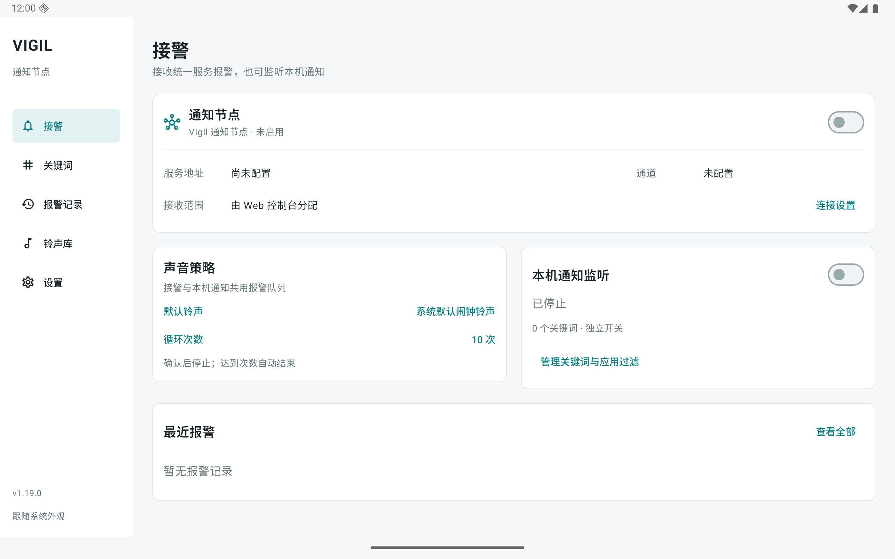

# Vigil

Android 通知与接警应用。可接收 VisionGuard 统一服务的实时报警，也可在本机按通知关键词触发铃声；在应用内确认停铃。

[快速开始](#快速开始) · [能做什么](#能做什么) · [界面预览](#界面预览) · [使用前注意](#使用前注意) · [文档索引](#文档索引)

  

## 快速开始

当前源码包含通知节点、新界面与修复，尚未发布。验证当前功能请按[源码构建](docs/release.md#本地调试构建)生成 APK；已发布包的范围以[发行说明](release-notes/)为准。Android 最低版本为 8.0。

1. 安装当前源码构建包；Android 13 及以上允许发送通知。
2. 本机通知：进入「关键词」添加词及应用过滤，授予通知使用权，在「接警」开启本机通知监听。
3. 服务接警：在「接警 → 连接设置」填写登记的通知身份、通道和 WSS 地址，保存后开启通知节点；Web 控制台分配全部或指定接收范围。两种接收方式使用独立开关。
4. 报警时在应用内点「已知晓，停止报警」。若应用在后台，可点报警通知进入处理。

## 能做什么

- 后台接收统一服务的实时报警、保存后确认收件；连接恢复不补响旧事件，持续无服务响应会产生本地中断提醒。
- 跟随系统浅色/深色，平板侧栏和手机布局共用功能。
- 按关键词和来源应用筛选通知；给不同关键词设置铃声与播放次数（1–10 次）。
- 选择立即报警、固定延时或每日定点；在设置中查看或取消待触发项。
- 让不同关键词的报警排队处理，配置重复提醒间隔，并查看报警记录。
- 导入或录制铃声、导出诊断日志，并从 GitHub 检查应用更新。

## 界面预览

## 使用前注意

- 服务接警需要已登记的通知节点身份；收件回执表示报警已保存，不保证声音播放。队列满或保存失败时不会确认，可在原 30 秒期限内重试。
- 厂商省电策略可能中断监听或服务连接；闹钟音量和系统勿扰规则会影响响铃。Vigil 不会修改系统勿扰设置。
- Android 10 及以上可能阻止应用从后台直接弹窗。点报警通知或手动打开应用即可处理。
- Android 12 及以上未授予「闹钟和提醒」时，延时报警可能晚于设定时间；设备关机期间不会响铃，重启后不保证按原计划准点触发。
- 报警队列和待触发列表各最多 20 项，队列满时不能接收更多即时报警；进程重建只恢复 30 分钟内且尚有播放次数的报警，延时项超过到期时间 12 小时后会丢弃。
- 开启「仅监听指定应用」后，未选应用意味着不检查任何应用；系统铃声选择器的「静音」不会播放声音，仍可在弹窗中确认报警。
- 关键词匹配在设备本地进行，诊断日志不写通知正文；启用通知节点会连接你配置的统一服务，更新检查和下载会访问 GitHub。节点凭据排除系统备份；详见[隐私政策](PRIVACY.md)。

## 文档索引

- [源码构建与发布](docs/release.md)：构建命令、签名和 CI 发版。
- [路线图](ROADMAP.md)：已确认的规划与完成记录；[发行说明](release-notes/)：各版本的用户可见变化。
- [项目规则](AGENTS.md)、[实现索引](docs/architecture.md)、[设备验证](docs/testing.md)与[平台兼容](docs/platform.md)：供开发维护时查阅。
- [商店素材](store/README.md)与[上架清单](store/owner-checklist.md)：应用商店资料。

欢迎通过 [GitHub Issues](https://github.com/XGWNJE/Vigil/issues) 反馈问题。代码采用 [MIT License](LICENSE)。
